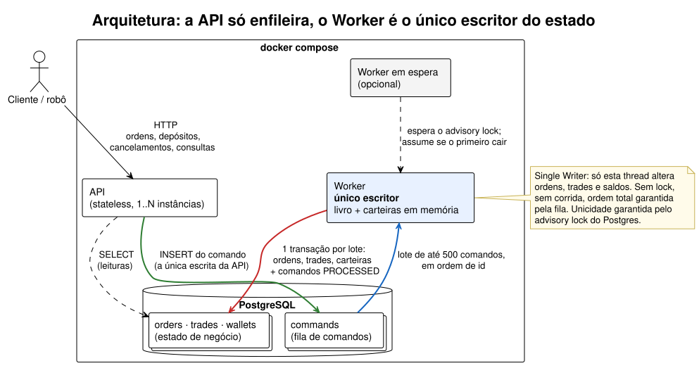

# Order Book de Vibranium

MVP de um livro de ofertas para negociar **Vibranium (VIB)** contra **reais (BRL)**

Java 21 · Spring Boot · PostgreSQL 18 · Docker Compose.

## Como rodar

Pré-requisito: Docker com Compose e as portas `8080` e `5432` livres.

```bash
docker compose up --build -d          # o primeiro build baixa as dependências (alguns minutos)
curl -s localhost:8080/actuator/health # aguarde "status":"UP"
```

Sobem três containers: **postgres** (schema criado de `db/*.sql` no primeiro start),
**api** em `http://localhost:8080` e **worker**. Para zerar o banco:
`docker compose down -v`.

## Premissas

- **Escala:** O alvo adotado é **5.000 req/s de envio de ordens**; os trades resultantes
  são medidos e reportados no teste de carga.
- **Tipos de ordem:** Foram implementados os dois
  básicos de um livro: **LIMIT** e **MARKET** (executa o que der na hora e cancela o resto).
- **Unidades:** VIB em unidades inteiras; BRL com 2 casas decimais.
- **Saldo inicial:** não há cadastro. A carteira nasce no primeiro **depósito**, que
  é a forma de colocar BRL ou VIB no sistema. Não há saque.
- **Usuário:** sem login, o `userId` vem na requisição. Num produto real, a
  autenticação ficaria num gateway antes da API, com o `userId` lido do token, e o
  cadastro seria um serviço próprio que cria a carteira zerada.
- **Processamento assíncrono:** a API aceita o comando (`202`) e o Worker o executa
  logo depois. O resultado de uma ordem é consultado em `GET /orders/{orderId}`.

## Usando a API

A forma mais rápida de testar é a **collection do Postman** que está no
repositório, em [`postman/order-book.postman_collection.json`](postman/order-book.postman_collection.json).
Importe-a e rode pelo **Runner**:

- **Fluxo principal**: depósitos, compra, reenvio idempotente, venda, livro, ordem,
  carteira, trades, extrato e cancelamento, em ordem. Cada execução cria usuários
  novos, então dá para rodar quantas vezes quiser sem limpar o banco.
- **Erros comuns**: requisições recusadas, com a mensagem de cada uma.

A URL fica na variável `baseUrl` (padrão `http://localhost:8080`). Abaixo, os
mesmos cenários com requisição e resposta reais.

### 1. Depositar

`POST /deposits`

```json
{ "userId": "alice", "depositId": "dep-1", "asset": "VIB", "amount": 10 }
```

```json
{ "userId": "bob", "depositId": "dep-1", "asset": "BRL", "amount": 1000.00 }
```

| Campo | Significado |
|---|---|
| `userId` | Dono da carteira. A carteira é criada no primeiro depósito. |
| `depositId` | Chave de idempotência escolhida pelo cliente. Reenviar o mesmo `depositId` não deposita de novo. |
| `asset` | `BRL` ou `VIB`. |
| `amount` | Valor positivo, com até 2 casas. VIB precisa ser inteiro. |

Resposta `202` (ou `200` num reenvio, com o status atual):

```json
{ "depositId": "dep-1", "status": "RECEIVED" }
```

### 2. Cenário LIMIT: alice vende, bob compra

Alice oferece 10 VIB a **10,00**. `POST /orders`:

```json
{ "userId": "alice", "clientOrderId": "venda-1", "side": "SELL", "type": "LIMIT", "price": 10.00, "quantity": 10 }
```

Bob aceita pagar **até 10,50** por 4 VIB. `POST /orders`:

```json
{ "userId": "bob", "clientOrderId": "compra-1", "side": "BUY", "type": "LIMIT", "price": 10.50, "quantity": 4 }
```

| Campo | Significado |
|---|---|
| `clientOrderId` | Chave de idempotência do cliente. Reenviar devolve a mesma ordem, sem duplicar. |
| `side` | `BUY` (compra VIB pagando BRL) ou `SELL` (vende VIB recebendo BRL). |
| `type` | `LIMIT` exige `price`; `MARKET` não aceita `price`. |
| `price` | Na compra, o máximo que aceita pagar por unidade; na venda, o mínimo que aceita receber. |
| `quantity` | Quantas unidades de VIB, inteiro positivo. |

Resposta `202`. O `orderId` serve para consultar a ordem depois:

```json
{ "orderId": "3da8b42c-4823-48c3-8128-4d3cce8be87f", "status": "RECEIVED" }
```

O trade saiu a **10,00**, o preço de quem já estava no livro. Bob tinha reservado
42,00 (10,50 × 4), pagou 40,00 e recebeu os 2,00 de volta.

`GET /orders/{orderId}` da compra de bob:

```json
{
  "orderId": "3da8b42c-4823-48c3-8128-4d3cce8be87f",
  "userId": "bob",
  "side": "BUY",
  "type": "LIMIT",
  "price": 10.50,
  "quantity": 4,
  "filledQuantity": 4,
  "status": "FILLED",
  "rejectReason": null,
  "createdAt": "2026-10-30T01:53:54.167649Z"
}
```

A venda de alice executou 4 de 10 e continua no livro (`GET /orders?side=SELL`),
com `"filledQuantity": 4` e `"status": "PARTIALLY_FILLED"`.

`GET /wallets/bob`:

```json
{
  "userId": "bob",
  "balances": [
    { "asset": "BRL", "available": 960.00, "reserved": 0.00 },
    { "asset": "VIB", "available": 4, "reserved": 0 }
  ]
}
```

- `available`: pode ser usado em novas ordens.
- `reserved`: está preso em ordens abertas. Uma compra LIMIT aberta reserva
  `price × restante` em BRL; uma venda aberta reserva o restante em VIB.

`GET /wallets/bob/statement` é o extrato, do mais recente para o mais antigo:

```json
{
  "userId": "bob",
  "items": [
    { "type": "BUY", "occurredAt": "2026-10-30T01:53:54.176888Z", "brlChange": -40.00, "vibChange": 4,
      "depositId": null, "tradeId": 1, "orderId": "3da8b42c-4823-48c3-8128-4d3cce8be87f",
      "price": 10.00, "quantity": 4 },
    { "type": "DEPOSIT", "occurredAt": "2026-10-30T01:53:52.565571Z", "brlChange": 1000.00, "vibChange": 0,
      "depositId": "dep-1", "tradeId": null, "orderId": null, "price": null, "quantity": null }
  ],
  "page": 0,
  "size": 20,
  "hasNext": false
}
```

**Como conferir os saldos:** para cada ativo, a soma de `brlChange` (ou
`vibChange`) de todas as linhas do extrato é igual a `available + reserved` da
carteira. No exemplo: 1000,00 − 40,00 = 960,00 BRL, e 0 + 4 = 4 VIB.

### 3. Cenário MARKET: comprar a qualquer preço

Bob quer 10 VIB agora, mas só restam 6 no livro (os de alice, a 10,00).
`POST /orders`:

```json
{ "userId": "bob", "clientOrderId": "compra-mercado-1", "side": "BUY", "type": "MARKET", "quantity": 10 }
```

`GET /orders/{orderId}`: bob comprou 6, e o restante foi cancelado. Uma ordem
MARKET nunca fica no livro.

```json
{
  "orderId": "538011b7-47e9-4405-9a27-1d6f37fcd3cf",
  "userId": "bob",
  "side": "BUY",
  "type": "MARKET",
  "price": null,
  "quantity": 10,
  "filledQuantity": 6,
  "status": "CANCELLED",
  "rejectReason": null,
  "createdAt": "2026-10-30T01:53:55.477434Z"
}
```

A carteira de bob passa a ter 900,00 BRL e 10 VIB. A compra MARKET não sabe o
preço final, então reserva todo o BRL disponível durante a execução e devolve o
que não gastou.

Se carol, sem saldo, envia a mesma ordem, ela é recusada:

```json
{ "status": "REJECTED", "rejectReason": "INSUFFICIENT_FUNDS", "filledQuantity": 0 }
```

### 4. Cancelar

`DELETE /orders/{orderId}?userId=bob` responde `202`. Em seguida,
`GET /orders/{orderId}` mostra `"status": "CANCELLED"`, e a reserva do restante
volta para `available`.

### 5. Erros

Erros de entrada respondem `400`, com uma mensagem por campo:

```json
{
  "status": 400,
  "title": "Bad Request",
  "detail": "A requisição tem campos inválidos.",
  "instance": "/orders",
  "errors": [
    { "field": "price", "message": "Ordens MARKET não aceitam price." },
    { "field": "quantity", "message": "O quantity deve ser maior que zero." }
  ]
}
```

Uma ordem inexistente responde `404`. Com o banco indisponível, a API responde
`503`, e reenviar com a mesma chave é seguro.

## Estados

### Comando

É o `status` na resposta de `POST /orders`, `POST /deposits` e `DELETE /orders/{orderId}`.

| Status | Significado |
|---|---|
| `RECEIVED` | Gravado na fila; o Worker ainda não aplicou. |
| `PROCESSED` | O Worker já aplicou. Aparece num reenvio feito depois do processamento. |

### Ordem

É o `status` em `GET /orders/{orderId}`.

```text
RECEIVED ──► NEW ──► PARTIALLY_FILLED ──► FILLED
   │          │             │
   │          └─────────────┴──► CANCELLED
   └──► REJECTED
```

| Status | Significado | Final? |
|---|---|---|
| `RECEIVED` | Aceita pela API, ainda na fila do Worker. | não |
| `NEW` | No livro, nada executado. | não |
| `PARTIALLY_FILLED` | Executou parte; o restante segue no livro. | não |
| `FILLED` | Executou tudo. | sim |
| `CANCELLED` | Cancelada pelo dono, ou sobra de uma MARKET. `filledQuantity` mostra o que chegou a executar. | sim |
| `REJECTED` | Não executou nada. O motivo está em `rejectReason`. | sim |

Uma ordem MARKET nunca fica `NEW` nem `PARTIALLY_FILLED`: vai direto para
`FILLED`, `CANCELLED` ou `REJECTED`.

### Quando algo não sai como esperado

| Você vê | Por quê | O que conferir |
|---|---|---|
| Ordem parada em `RECEIVED` | O Worker ainda não processou ou está reiniciando. Nada se perde: os comandos esperam na fila. | `GET /actuator/health`: o componente `worker` deve estar `UP`. |
| `REJECTED` com `INSUFFICIENT_FUNDS` | O `available` não cobria a reserva: `price × quantity` em BRL na compra LIMIT, `quantity` em VIB na venda. Na compra MARKET, o BRL não paga nem uma unidade ao melhor preço. | `GET /wallets/{userId}`. O depósito precisa ter sido enviado antes da ordem. |
| `REJECTED` com `NO_LIQUIDITY` | Ordem MARKET sem nenhuma ordem do outro lado. | `GET /orders?side=` do lado oposto. |
| Cancelamento com `202`, mas a ordem não ficou `CANCELLED` | A ordem já tinha terminado (`FILLED`, `REJECTED` ou MARKET), ou o `userId` não é o dono. O pedido é ignorado. | `GET /orders/{orderId}`: o status e o `userId`. |
| Saldo diferente do esperado | Parte do valor pode estar em `reserved`, presa em ordens abertas. | `available + reserved` deve bater com a soma do extrato; ordens abertas em `GET /orders?side=&userId=`. |

## Endpoints

| Método | Rota | O que faz |
|---|---|---|
| POST | `/deposits` | Registra um depósito de BRL ou VIB; a carteira nasce no primeiro depósito. |
| POST | `/orders` | Envia uma ordem LIMIT ou MARKET de compra ou venda; reenvio com o mesmo `clientOrderId` não duplica. |
| DELETE | `/orders/{orderId}?userId=` | Pede o cancelamento de uma ordem aberta; o restante da reserva volta para o saldo. |
| GET | `/orders/{orderId}` | Estado da ordem (`RECEIVED` enquanto está na fila, depois `NEW`, `PARTIALLY_FILLED`, `FILLED`, `CANCELLED` ou `REJECTED`). |
| GET | `/orders?side=&userId=&page=&size=` | Ordens abertas de um lado do livro, na prioridade de execução. |
| GET | `/wallets/{userId}` | Saldos `available` e `reserved` de BRL e VIB. |
| GET | `/wallets/{userId}/statement` | Extrato: depósitos e trades com a variação de cada ativo; a soma bate com o saldo total. |
| GET | `/trades?userId=&page=&size=` | Histórico de execuções do usuário, como comprador ou vendedor. |
| GET | `/actuator/health`, `/actuator/prometheus` | Saúde da API, do banco e do Worker; métricas do motor. |

Escritas respondem **202** (aceito na fila) ou **200** (reenvio idempotente).
Erros de validação respondem **400** com uma mensagem por campo.

## O que a solução suporta

| Suporta | Detalhe |
|---|---|
| Ordem **LIMIT** | Executa até o preço limite; o que sobrar descansa no livro até executar ou ser cancelado. |
| Ordem **MARKET** | Executa o que houver, a qualquer preço, e **nunca entra no livro**: a sobra é cancelada (`CANCELLED`), ou a ordem é rejeitada (`REJECTED`) se nada executou. |
| Prioridade preço-tempo | Melhor preço primeiro; no mesmo preço, a ordem mais antiga. |
| Preço do maker | O trade sai ao preço de quem já estava no livro; a melhora volta para quem chegou. |
| Execução parcial | Uma ordem pode executar em vários trades, inclusive depois de um restart. |
| Reserva de saldo | Compra LIMIT reserva `preço × quantidade` em BRL; compra MARKET reserva todo o BRL disponível e devolve a sobra; venda reserva a quantidade em VIB. Sem saldo: `REJECTED (INSUFFICIENT_FUNDS)`. |
| Idempotência | Ordens, depósitos e cancelamentos podem ser reenviados sem efeito duplicado. |

**Não suporta, por decisão de escopo:**

- **Outros tipos de ordem** (stop, iceberg, post-only): LIMIT e MARKET são os
  tipos básicos de um livro, e cada tipo novo traz estados e casos de borda sem
  ganho para o MVP.
- **Saque, autenticação e cadastro de usuários**: dispensados; o
  `userId` vem na requisição (ver [Premissas](#premissas)).
- **Mais de um ativo**: só VIB/BRL. O caminho para crescer é um Worker por ativo.
- **Self-trade prevention**: um usuário pode cruzar com a própria ordem; os
  saldos continuam corretos.

## Arquitetura



- **A API só escreve na fila** (`commands`). Ela valida o formato, mas **não
  olha saldo**: uma checagem de saldo sem lock não seria confiável.
- **Um único Worker** lê a fila em ordem, faz o matching e a liquidação **em
  memória**, um comando por vez, e grava o lote inteiro numa transação, junto
  com a marcação dos comandos como processados. Ou o lote inteiro entra, ou
  nada entra: nenhum comando é aplicado duas vezes, mesmo com queda.
- **O banco é a verdade.** Se o Worker cair ou um commit falhar, ele encerra e,
  ao subir, reconstrói o livro e as carteiras a partir das tabelas.

Diagramas de sequência, passo a passo:
[ordem](docs/diagramas/fluxo-ordem.svg) ·
[depósito](docs/diagramas/fluxo-deposito.svg) ·
[cancelamento](docs/diagramas/fluxo-cancelamento.svg)

### Single Writer Principle

O desenho segue o *Single Writer Principle*, popularizado pela LMAX (uma bolsa
que processa milhões de ordens por segundo numa única thread): **cada estado
mutável tem exatamente um escritor**; os demais só leem ou enviam mensagens a ele.

| Estado | Quem escreve | Os demais |
|---|---|---|
| Ordens, trades e saldos | **só o Worker** | a API apenas lê |
| Fila `commands` | a API acrescenta comandos | o Worker só os marca como processados |

Por que isso resolve o problema central de um livro de ofertas:

- **Sem corrida no saldo.** Duas ordens gastando o mesmo BRL ao mesmo tempo não
  existem, porque ninguém mais altera a carteira. Com vários escritores, seria
  preciso lock por carteira e por nível de preço, e cuidado com deadlock.
- **Ordem total e determinismo.** A fila define a ordem de chegada; processar
  os mesmos comandos de novo dá o mesmo resultado. É isso que torna a
  recuperação após uma queda segura.
- **Rápido.** Livro e carteiras ficam em memória, sem lock nem ida ao banco por
  comando; o custo é um commit por lote. No teste de carga, o Worker usou 19% de
  CPU a ~4.400 ordens/s.

O preço, e como é tratado: a vazão de um escritor tem teto (mitigado pelo lote,
e o próximo passo é **um escritor por ativo**, cada livro com o seu Worker), e
um processo único é ponto de falha (ele reinicia e reconstrói o estado do
banco; o advisory lock garante que nunca haja dois escritores, e um segundo
Worker pode ficar em espera).

### Decisões principais

| Decisão | Por quê | Descartado |
|---|---|---|
| **Fila em tabela do Postgres** | O comando fica durável antes de ser processado, e o "processado" commita junto com os efeitos: exactly-once sem coordenar dois sistemas. | **Kafka**: vazão de sobra, mas exigiria coordenar offset com a transação do banco e mais infraestrutura para subir e operar. Complexidade sem retorno num MVP. |
| **Worker único, livro em memória** | O livro não admite concorrência. Serializar num processo elimina lock e corrida, e o matching leva microssegundos. | **Redis** para livro ou saldo: mais um componente, e ainda precisaria de lock distribuído ou scripts atômicos sincronizados com o banco. A memória do Worker é reconstruída do Postgres. |
| **Um Worker garantido pelo banco** | Um advisory lock do Postgres impede dois Workers por engano; um segundo fica em espera e assume se o primeiro cair. | Lease com tabela de controle. |
| **Lote de até 500 comandos** | Um round trip por tabela por lote, com inserts agrupados pelo driver. | Um statement por linha. |
| **`BigDecimal` com 2 casas; VIB inteiro** | `preço × quantidade` é exato; nenhum arredondamento no dinheiro. | Centavos em `long`. |

## Falhas

| O que falha | O que acontece | Perde algo? |
|---|---|---|
| Worker cai no meio de um lote | Os comandos seguem na fila; ele sobe (`restart: always`), reconstrói o estado e reprocessa. | Não |
| Commit do lote falha | O Worker encerra de propósito e reconstrói do banco. | Não |
| Dois Workers ao mesmo tempo | O segundo espera o lock e assume quando o primeiro morre. | Não |
| API cai | Nenhuma ordem nova entra; o que já foi aceito está no banco. | Não |
| Postgres indisponível | A API responde 503 (o cliente reenvia com a mesma chave); o Worker encerra e volta sozinho quando o banco volta. | Não |

## Teste de carga

Script [k6](https://k6.io) em [`tools/load/orders.js`](tools/load/orders.js):
deposita saldo para 200 usuários, envia `POST /orders` LIMIT a **taxa constante de
5.000 req/s por 60 s**, e no fim mede quanto o Worker leva para esvaziar a fila.

**Ambiente:** Ryzen 5 5600X (6 núcleos/12 threads), Docker no WSL2, **tudo na mesma
máquina**: gerador de carga, nginx, 4 instâncias da API, Postgres e Worker.

| Medida | Resultado |
|---|---|
| Ordens aceitas | **4.431 req/s** (292.976 em 60 s; 2,3% da taxa pedida não foi enviada a tempo) |
| Latência de aceite | mediana **2 ms**, p95 145 ms, p99 425 ms |
| Erros | **0** |
| Trades executados | **213.694** (~3.500/s) |
| Fila do Worker ao fim da carga | **0** |
| CPU (100% = 1 thread) | Postgres 223% · gerador 165% · nginx 99% · cada API ~45% · Worker 19% |

**O que descobrimos:**

- **O Worker não é o gargalo.** Com 19% de CPU ele acompanhou ~4.400 ordens/s
  e terminou com a fila vazia: a parte serializada do desenho tem folga.
- **As APIs estavam folgadas** (~45% de CPU cada), e o container mais ocupado
  foi o **Postgres**, que faz um commit durável por requisição aceita.
- Os 5.000 req/s não foram sustentados por inteiro **numa máquina só**, que
  ainda dividia CPU com o próprio gerador de carga. Os próximos passos seriam
  Postgres em máquina e disco próprios e agrupar mais commits por flush, sem
  abrir mão da durabilidade.

**Reproduzir** (com o compose de pé):

```bash
docker run --rm -i --network order-book_default -e BASE_URL=http://api:8080 \
  grafana/k6 run - < tools/load/orders.js
```

O cenário com 4 APIs atrás de um nginx usa um override só para o teste:

```bash
docker compose -f docker-compose.yml -f docker-compose.scale.yml up --build -d --scale api=4
docker run --rm -i --network order-book_default -e BASE_URL=http://nginx \
  -e VUS=1500 -e MAX_VUS=3000 grafana/k6 run - < tools/load/orders.js
```

## Testes

- **Automatizados** (`mvn clean verify`, exige Java 21 e Maven): 174 testes. Do
  motor: três exemplos completos conferidos centavo a centavo, os 15 casos de borda de execução
  parcial e cancelamento, e um teste de propriedade com **10 mil comandos
  aleatórios** que confere as invariantes de saldo depois de **cada** comando.

## Estrutura

```text
order-book-api/      HTTP, escrita na fila, leituras, métricas e health
order-book-worker/   matching, liquidação, loop, persistência do lote
order-book-shared/   tipos usados pelos dois (enums de domínio)
db/                  schema (scripts SQL numerados); db/dev/ scripts de apoio
docs/diagramas/      arquitetura e fluxos de sequência (PlantUML e SVG)
tools/load/          teste de carga (k6)
postman/             collection com o fluxo completo e os erros
```
